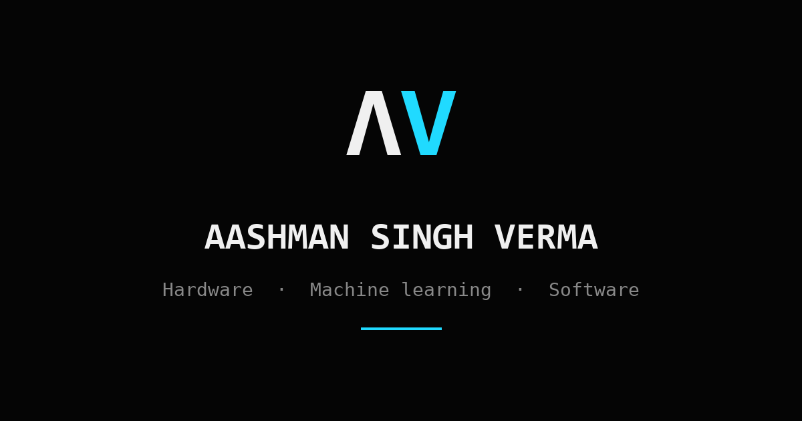

# not-aashman.github.io

This is the code behind my personal site. It's where I keep the things I've built, what I've studied and a way to get in touch, all wrapped in a dark, slightly glitchy look that I had far more fun making than I expected to.

**→ [Visit the site](https://not-aashman.github.io)**

## How it's made

Everything is hand-written HTML, CSS and JavaScript. No framework, no build step, and possibly a few more animations than strictly necessary.

- Headings unscramble themselves as they come into view.
- A field of cyan particles drifts behind the whole page.
- Images stay black and white until you hover over them.
- Scanlines, Japanese text and a dot-matrix font hold the look together.

It still behaves when it should: with reduced motion turned on, nothing scrambles or drifts, and with JavaScript off, every word is still there.

## Easter eggs

There are a few hidden around the site, and not all of them explain themselves. Cheats are off, so you'll have to find them yourself.

## Built with

[GSAP](https://gsap.com/) and ScrollTrigger · [Lenis](https://github.com/darkroomengineering/lenis) · [Three.js](https://threejs.org/) · Google Fonts (Doto, Alata, JetBrains Mono, Reggae One) · hosted on GitHub Pages

---

Thanks for reading this far :)
